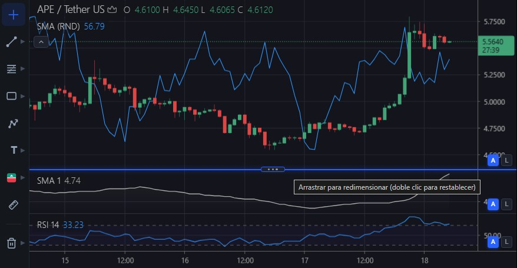

# 🌙 NightVision Charts (Edición Comunitaria Vibe-Coded)

<div align="center">

[](LICENSE)
[]()
[]()
[]()

**[ English ](README.md) • [ Español ](README.es.md)**

<br/>



<br/><br/>

### **Librería de gráficos financieros ultrarrápida y altamente personalizable para cripto, acciones y trading profesional.**

**NightVision Charts** es una librería moderna, ligera y de alto rendimiento diseñada para aplicaciones web, exchanges de criptomonedas, plataformas fintech y paneles de trading algorítmico. Construida sobre un motor Canvas 2D acelerado con Svelte, ofrece un renderizado fluido a 60 FPS incluso bajo streaming continuo de datos por WebSocket y configuraciones complejas de múltiples paneles e indicadores.

Ya sea que busques una alternativa abierta y flexible a TradingView, diseñar indicadores propios mediante el motor reactivo **NavyJS** o integrar herramientas interactivas de análisis técnico, NightVision te brinda libertad arquitectónica total sin dependencias pesadas ni ataduras.

</div>

> **Aviso y Atribución:**  
> Este proyecto es un fork comunitario del proyecto original [NightVision Charts](https://github.com/project-nv/night-vision) creado por [ChartMaster](https://github.com/project-nv).  
> Ha sido ampliamente mejorado, modernizado y **vibecodeado con asistencia de Inteligencia Artificial**, incorporando paridad con herramientas interactivas estilo TradingView, barra de herramientas lateral (Toolbar) y barra rápida flotante, diseño totalmente responsive con soporte táctil, API de datos Datafeed para streaming WebSocket en tiempo real, un catálogo modal con más de 30 indicadores técnicos, persistencia completa del espacio de trabajo y correcciones críticas de rendimiento y renderizado.

---

## ✨ Características Principales

### 🛠️ Barra de Herramientas de Dibujo (Toolbar) y Barra Flotante Rápida
- **Barra Lateral de Dibujo (Drawing Toolbar)**: Barra vertical completa con menús desplegables (flyouts) organizados por categorías: Líneas de tendencia, Fibonacci, Figuras geométricas, Texto, Herramientas de medición y Posiciones de trading.
- **Barra Flotante Contextual (Floating Toolbar)**: Aparece de forma automática al seleccionar cualquier dibujo en el gráfico. Permite configurar el color de trazo, color de fondo, opacidad, grosor de línea (1px a 4px), estilo de trazo (sólido, discontinuo, punteado), orden de capas (z-index), duplicar y eliminar.
- **Modal de Ajustes con Doble Clic**: Al hacer doble clic en cualquier dibujo, se abre un cuadro de diálogo detallado para editar coordenadas numéricas exactas, textos y colores.
- **Suite Completa de Herramientas Estilo TradingView**:
  - **Fibonacci**: Retrocesos de Fibonacci, Círculos de Fibonacci elípticos (con semiejes matemáticos adaptados dinámicamente a la escala de precio y tiempo) y Cuña de Fibonacci.
  - **Herramienta de Medición (Measure Tool)**: Conteo exacto de barras, duración temporal, variación de precio, retorno porcentual y volumen acumulado.
  - **Figuras Geométricas**: Rectángulo, Círculo, Elipse, Arco de 3 puntos, Triángulo y Polilínea / Trayectoria (Path).
  - **Líneas y Rayos**: Línea de tendencia, Semirrecta (Rayo infinito), Línea horizontal y Línea vertical.
  - **Anotaciones y Gestión de Riesgo**: Textos y herramientas de Posición Larga / Corta con cálculo automático de riesgo/beneficio.

### 📱 Diseño Totalmente Responsive y Soporte Móvil
- **Redimensionamiento Automático**: Se adapta de forma dinámica al tamaño del contenedor mediante `ResizeObserver` al activar `autoResize: true`.
- **Gestos Táctiles Móviles**: Soporta pellizco para zoom (*pinch-to-zoom*), arrastre con un dedo para scroll, cruceta con presión sostenida y pulsación para seleccionar.
- **Barra Responsive Adaptativa**: La barra de herramientas lateral detecta pantallas pequeñas o dispositivos móviles y se colapsa de forma inteligente para maximizar el área visible del gráfico.

### ⚡ API de Datos Datafeed y Motor en Tiempo Real
- **Contrato `BaseDatafeed`**: Clase base para conectar cualquier API REST o WebSocket de exchange (Binance, Bybit, Coinbase o backend propio).
- **`DatafeedManager`**: Gestiona la paginación de velas históricas en scroll infinito hacia el pasado, actualización de velas activas en vivo y cambio dinámico de símbolo o timeframe sin reiniciar los dibujos ni los indicadores.
- **Streaming de Alto Rendimiento**: Actualiza la vela actual barra a barra con mínimo consumo de CPU y renderizado de alta velocidad.

### 📊 Catálogo Modal de Indicadores Integrado
- **Apertura en un Solo Clic**: Diálogo modal interactivo (`chart.openIndicatorsModal()`) categorizado por Tendencia, Osciladores, Volatilidad, Volumen y Scripts Personalizados.
- **Más de 30 Indicadores Preconstruidos**: SMA, EMA, HMA, ALMA, VWMA, VWAP, Nube de Ichimoku, SAR Parabólico, Ribbon de EMAs, RSI, MACD, Estocástico, CCI, CMO, COG, DMI/ADX, MFI, Momentum, ROC, TSI, Williams %R, Bandas de Bollinger (BB, BBW), Canales de Keltner (KC, KCW), ATR, Delta de Volumen, SuperBands, entre otros.
- **Detección Automática de Scripts NavyJS**: Cualquier script personalizado `.navy` colocado en tu proyecto se indexa y se muestra automáticamente en el catálogo.

### 📈 Tipos de Gráficos Dinámicos
- Cambia al instante entre Velas Japonesas (`Candles`), Barras OHLC (`Bars`), `HeikinAshi`, Velas Huecas (`HollowCandles`), Gráfico de Área (`Area`), Línea Base (`Baseline`) y Línea Continua (`Spline`).

### 💾 Persistencia de Dibujos y Plantillas (Layout Persistence)
- Exporta y restaura el estado completo del gráfico (`saveLayout()` y `loadLayout()`), incluyendo dibujos, indicadores activos, escalas, colores y distribución de paneles en `localStorage` o bases de datos remotas.

### 🤖 Skills de Desarrollo Asistido por IA Incluidas (`.agents/skills/`)
Este repositorio está preparado para desarrollo con IA e incluye guías y reglas arquitectónicas en `.agents/skills/` diseñadas para asistir a agentes de codificación (Cursor, Claude Code, Copilot, Antigravity, etc.):
- **`night-vision-tools`**: Reglas matemáticas, proyección de coordenadas y plantillas para crear y mantener herramientas de dibujo interactivas.
- **`nightvision-datafeed`**: Guía y especificación para implementar adaptadores de datos en tiempo real (WebSockets, paginación histórica y canales avanzados).
- **`nightvision-indicator-builder`**: Manual de referencia para crear y portar indicadores técnicos y overlays mediante NavyJS.
- **`nightvision-layout-persistence`**: Serialización de espacios de trabajo, auto-guardado reactivo y adaptadores de almacenamiento (*StorageAdapter*).

---

## 🚀 Instalación

### Opción 1: Instalar directamente desde GitHub
```bash
npm install github:<tu-usuario>/night-vision
```

### Opción 2: Clonar y Compilar Localmente
```bash
git clone https://github.com/<tu-usuario>/night-vision.git
cd night-vision
npm install
npm run build
```

---

## 📖 Guía Rápida de Uso

### 1. Inicialización Básica del Gráfico

```html
<div id="chart-container" style="width: 100%; height: 600px;"></div>

<script type="module">
import { NightVision } from 'night-vision'

// Formato OHLCV: [timestamp, open, high, low, close, volume]
const ohlcv = [
    [1672531199000, 16500, 16600, 16450, 16580, 120.5],
    [1672531259000, 16580, 16700, 16550, 16680, 145.2],
    [1672531319000, 16680, 16750, 16620, 16710, 98.4]
]

const chart = new NightVision('chart-container', {
    data: {
        panes: [{
            overlays: [{
                name: 'BTC/USDT',
                type: 'Candles',
                main: true,
                data: ohlcv
            }]
        }]
    },
    autoResize: true, // Ajuste responsive automático a la pantalla o contenedor
    toolbar: true     // Habilita la barra de herramientas de dibujo lateral
})
</script>
```

---

### 2. Uso de la API de Datos Datafeed (Tiempo Real y Paginación)

Conecta tu fuente de datos REST y WebSocket mediante la interfaz `BaseDatafeed`:

```javascript
import { NightVision, BaseDatafeed } from 'night-vision'

class MiDatafeedCrypto extends BaseDatafeed {
    // 1. Obtener velas históricas para la carga inicial y el scroll infinito hacia el pasado
    async fetchHistoricalBars(symbol, timeframe, from, to) {
        const respuesta = await fetch(`/api/klines?symbol=${symbol}&tf=${timeframe}&from=${from}&to=${to}`)
        const datos = await respuesta.json()
        return datos // Debe retornar un array de [timestamp, open, high, low, close, volume]
    }

    // 2. Suscribirse al streaming en vivo por WebSocket
    subscribeRealtime(symbol, timeframe, onBarUpdate) {
        const ws = new WebSocket(`wss://stream.mi-exchange.com/ws/${symbol}@kline_${timeframe}`)
        ws.onmessage = (evento) => {
            const vela = JSON.parse(evento.data)
            // Envía la actualización de la vela al gráfico en tiempo real
            onBarUpdate([vela.t, vela.o, vela.h, vela.l, vela.c, vela.v])
        }
        // Retorna la función de desuscripción al cambiar de símbolo o destruir el gráfico
        return () => ws.close()
    }
}

// Inicializar el gráfico con el Datafeed:
const chart = new NightVision('chart-container', {
    autoResize: true,
    toolbar: true
})

const datafeed = new MiDatafeedCrypto()
chart.setDatafeed(datafeed, 'BTC/USDT', '1h')

// Cambiar de símbolo o de timeframe dinámicamente en cualquier momento:
chart.setSymbol('ETH/USDT', '15m')
chart.setTimeframe('4h')
```

---

### 3. Apertura del Catálogo Modal de Indicadores

Abre la ventana modal directamente desde tu barra de navegación, menú o botones de interfaz:

```javascript
// Abrir el catálogo modal de indicadores:
chart.openIndicatorsModal()

// O mediante emisión de evento:
chart.events.emit('open-indicators-modal')
```

También puedes agregar indicadores directamente por código sin abrir la ventana:
```javascript
// Agregar indicador en un panel inferior independiente (ej. RSI, MACD, Volumen):
chart.addIndicator('RSI')
chart.addIndicator('MACD')

// Agregar indicador superpuesto en el gráfico principal de precios:
chart.addIndicator('EMA', { length: 20 })
chart.addIndicator('SMA', { length: 200 })
chart.addIndicator('BB') // Bandas de Bollinger
```

---

### 4. Cambio Dinámico del Tipo de Gráfico

Cambia el tipo de representación visual de las velas en caliente sin perder indicadores ni dibujos:

```javascript
// Tipos soportados: 'Candles', 'Bars', 'HeikinAshi', 'HollowCandles', 'Area', 'Baseline', 'Spline'
function cambiarTipoGrafico(tipo) {
    if (chart.hub && chart.hub.mainOv) {
        chart.hub.mainOv.type = tipo
        chart.update('full')
    }
}

// Ejemplos de uso:
cambiarTipoGrafico('HeikinAshi')    // Velas Heikin Ashi
cambiarTipoGrafico('Bars')          // Barras clásicas OHLC
cambiarTipoGrafico('HollowCandles') // Velas huecas
cambiarTipoGrafico('Area')          // Gráfico de área tipo montaña
cambiarTipoGrafico('Candles')       // Velas tradicionales
```

---

### 5. Guardar y Restaurar Dibujos y Plantillas (Layout Persistence)

Guarda las anotaciones del usuario, herramientas dibujadas, indicadores y escalas en `localStorage` o en tu base de datos:

```javascript
// Guardar el layout completo
const layout = chart.saveLayout()
localStorage.setItem('mi_grafico_layout', JSON.stringify(layout))

// Restaurar el layout en cualquier momento
const guardado = localStorage.getItem('mi_grafico_layout')
if (guardado) {
    chart.loadLayout(JSON.parse(guardado))
}
```

---

## 🛠️ Comandos de Desarrollo y Compilación

```bash
# Iniciar servidor local de desarrollo con recarga rápida (HMR)
npm run dev

# Compilar librería para producción (genera bundles ES y UMD en /dist)
npm run build

# Previsualizar la compilación local
npm run preview
```

---

## 📄 Licencia y Reconocimientos

- **Proyecto Base**: Desarrollado originalmente por [ChartMaster](https://github.com/project-nv) bajo licencia ISC / MIT.
- **Edición Comunitaria**: Modernizado y vibecodeado con asistencia de Inteligencia Artificial para ofrecer una experiencia gráfica profesional lista para producción en aplicaciones web modernas.
