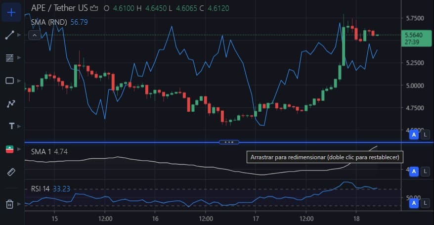

# 🌙 NightVision Charts (Community Vibe-Coded Edition)

<div align="center">

[](LICENSE)
[]()
[]()
[]()

**[ English ](README.md) • [ Español ](README.es.md)**

<br/>



</div>

> **Notice & Attribution:**  
> This project is a community-driven fork of the original [NightVision Charts](https://github.com/project-nv/night-vision) created by [ChartMaster](https://github.com/project-nv).  
> It has been extensively enhanced, modernized, and **vibe-coded with AI assistance**, adding complete TradingView-grade interactive drawing tools, a left sidebar toolbar & floating quick toolbar, full responsive mobile/touch support, a comprehensive Datafeed API for real-time WebSocket streaming, an indicator catalog modal featuring 30+ technical indicators, workspace persistence, and critical rendering fixes.

---

## ✨ Highlights & Key Features

### 🛠️ Interactive Drawing Toolbar & Floating Quick Toolbar
- **Left Sidebar Toolbar**: Full-featured vertical drawing toolbar with category flyout menus (Lines, Fibonacci, Shapes, Text, Measurement, and Positions).
- **Floating Contextual Toolbar**: Appears automatically above any selected drawing. Adjust line color, fill color, opacity, line width (1px–4px), dash style (solid, dashed, dotted), z-index ordering, clone/duplicate, and delete.
- **Double-Click Settings Modal**: Double-click any drawing on the canvas to open a detailed properties dialog for coordinates, text labels, and style options.
- **Complete TradingView Tool Suite**:
  - **Fibonacci Suite**: Retracements, Elliptical Fibonacci Circles (mathematically adapting semiaxes to price/time scales), and Fibonacci Wedge.
  - **Measurement Tool**: Calculates bar count, time duration, price change, percentage return, and cumulative volume.
  - **Geometric Shapes**: Rectangles, Circles, Ellipses, 3-point Arcs, Triangles, and Multi-point Paths.
  - **Lines & Rays**: Trend Lines, Infinite Rays, Horizontal Lines, and Vertical Lines.
  - **Annotations & Strategy**: Text labels and Long/Short Position risk/reward calculators.

### 📱 Fully Responsive & Mobile-Ready
- **Dynamic Resize**: Automatically tracks container resize using `ResizeObserver` when `autoResize: true` is enabled.
- **Touch Gestures**: Seamless pinch-to-zoom, single-finger panning, crosshair aiming, and tap-to-select.
- **Adaptive UI**: The drawing toolbar and overlays automatically adapt and collapse cleanly on mobile devices and narrow viewports to maximize chart visibility.

### ⚡ Datafeed API & Real-Time Engine
- **`BaseDatafeed` Contract**: Standard abstract class to plug into any REST API or WebSocket stream (Binance, Bybit, Coinbase, custom backend).
- **`DatafeedManager`**: Handles historical bar pagination on infinite scroll backwards, live ticker updates, and seamless symbol/timeframe switching without resetting overlays.
- **Real-Time Precision**: Updates the active candle bar-by-bar in real time with high rendering performance.

### 📊 Built-in Indicator Catalog Modal
- **One-Click Catalog**: Instant modal dialog (`chart.openIndicatorsModal()`) categorized by Trend, Oscillators, Volatility, Volume, and Custom scripts.
- **30+ Indicators Included**: SMA, EMA, HMA, ALMA, VWMA, VWAP, Ichimoku Cloud, Parabolic SAR, Ribbon, RSI, MACD, Stochastic, CCI, CMO, COG, DMI/ADX, MFI, Momentum, ROC, TSI, Williams %R, Bollinger Bands (BB, BBW), Keltner Channels (KC, KCW), ATR, Volume Delta, SuperBands, and more.
- **Custom NavyJS Indicators**: Drop any custom `.navy` script into your project and it will automatically be detected and listed in the catalog.

### 📈 Dynamic Chart Types
- Switch between Candlesticks (`Candles`), `Bars`, `HeikinAshi`, `HollowCandles`, `Area`, `Baseline`, and `Spline` in real time with a single function call.

### 💾 Layout & Workspace Persistence
- Export and restore the entire chart state (`saveLayout()` and `loadLayout()`) including drawings, indicators, scales, colors, and pane splits to `localStorage` or remote databases.

---

## 🚀 Installation

### Option 1: Install directly from GitHub
```bash
npm install github:<your-username>/night-vision
```

### Option 2: Clone & Build Locally
```bash
git clone https://github.com/<your-username>/night-vision.git
cd night-vision
npm install
npm run build
```

---

## 📖 Quickstart Guide

### 1. Basic Chart Initialization

```html
<div id="chart-container" style="width: 100%; height: 600px;"></div>

<script type="module">
import { NightVision } from 'night-vision'

// OHLCV Format: [timestamp, open, high, low, close, volume]
const ohlcv = [
    [1672531199000, 16500, 16600, 16450, 16580, 120.5],
    [1672531259000, 16580, 16700, 16550, 16680, 145.2],
    [1672531319000, 16680, 16750, 16620, 16710, 98.4]
]

const chart = new NightVision('chart-container', {
    data: {
        panes: [{
            overlays: [{
                name: 'BTC/USDT',
                type: 'Candles',
                main: true,
                data: ohlcv
            }]
        }]
    },
    autoResize: true, // Responsive layout tracking
    toolbar: true     // Enables the left drawing toolbar
})
</script>
```

---

### 2. Using the Datafeed API (Real-Time & Historical Data)

Connect your exchange or backend API using the `BaseDatafeed` interface:

```javascript
import { NightVision, BaseDatafeed } from 'night-vision'

class MyCryptoDatafeed extends BaseDatafeed {
    // 1. Fetch historical bars for initial load & infinite scroll
    async fetchHistoricalBars(symbol, timeframe, from, to) {
        const response = await fetch(`/api/klines?symbol=${symbol}&tf=${timeframe}&from=${from}&to=${to}`)
        const data = await response.json()
        return data // Must return array of [timestamp, open, high, low, close, volume]
    }

    // 2. Subscribe to live WebSocket updates
    subscribeRealtime(symbol, timeframe, onBarUpdate) {
        const ws = new WebSocket(`wss://stream.exchange.com/ws/${symbol}@kline_${timeframe}`)
        ws.onmessage = (event) => {
            const bar = JSON.parse(event.data)
            // Push bar update to chart
            onBarUpdate([bar.t, bar.o, bar.h, bar.l, bar.c, bar.v])
        }
        // Return unsubscribe function
        return () => ws.close()
    }
}

// Attach datafeed to chart:
const chart = new NightVision('chart-container', {
    autoResize: true,
    toolbar: true
})

const datafeed = new MyCryptoDatafeed()
chart.setDatafeed(datafeed, 'BTC/USDT', '1h')

// Switch symbol or timeframe dynamically at any time:
chart.setSymbol('ETH/USDT', '15m')
chart.setTimeframe('4h')
```

---

### 3. Opening the Indicator Catalog Modal

Open the built-in modal programmatically from your navigation bar or header button:

```javascript
// Open the catalog modal:
chart.openIndicatorsModal()

// Alternatively, emit the event:
chart.events.emit('open-indicators-modal')
```

You can also add indicators directly from code without opening the modal:
```javascript
// Add an indicator in a new sub-pane below (e.g., RSI, MACD, Volume):
chart.addIndicator('RSI')
chart.addIndicator('MACD')

// Add an indicator overlay to the main price pane:
chart.addIndicator('EMA', { length: 20 })
chart.addIndicator('SMA', { length: 200 })
chart.addIndicator('BB') // Bollinger Bands
```

---

### 4. Changing Chart Types On-the-Fly

Change the primary chart visual mode dynamically without resetting indicators or drawings:

```javascript
// Supported types: 'Candles', 'Bars', 'HeikinAshi', 'HollowCandles', 'Area', 'Baseline', 'Spline'
function switchChartType(type) {
    if (chart.hub && chart.hub.mainOv) {
        chart.hub.mainOv.type = type
        chart.update('full')
    }
}

// Examples:
switchChartType('HeikinAshi')  // Heikin Ashi candles
switchChartType('Bars')        // Traditional OHLC bars
switchChartType('HollowCandles') // Hollow candlesticks
switchChartType('Area')        // Mountain / Area gradient chart
switchChartType('Candles')     // Standard solid candlesticks
```

---

### 5. Saving and Restoring Workspaces (Layout Persistence)

Save the user's drawings, indicators, colors, and pane configurations to `localStorage` or your backend database:

```javascript
// Export current layout
const layout = chart.saveLayout()
localStorage.setItem('user_chart_layout', JSON.stringify(layout))

// Restore layout at any time
const saved = localStorage.getItem('user_chart_layout')
if (saved) {
    chart.loadLayout(JSON.parse(saved))
}
```

---

## 🛠️ Development & Build Commands

```bash
# Start local Vite development server
npm run dev

# Compile production bundle (ES Module & UMD in /dist)
npm run build

# Preview production build locally
npm run preview
```

---

## 📄 License & Acknowledgments

- **Original Project**: Created by [ChartMaster](https://github.com/project-nv) under the ISC / MIT license.
- **Community Edition**: Modernized and vibe-coded with AI assistance to deliver production-ready TradingView-level charting capabilities for modern web applications.
